# Breast Cancer Prediction: Machine Learning Web App


An end-to-end machine learning project that predicts whether a breast tumour is **benign** or **malignant** from measurements of cell nuclei. It covers data exploration, model comparison, overfitting diagnosis, final evaluation, and an interactive **Streamlit** web app deployed on **Render**.

> **Disclaimer:** This is an educational capstone project. It is **not a medical device** and must not be used for real diagnosis or treatment decisions. Always consult a qualified clinician.

**Live app:** _add your Render URL here (for example `https://breast-cancer-predictor.onrender.com`)_
_The free Render tier sleeps when idle, so the first load can take 30 to 60 seconds._

---

## Table of contents
1. [Overview](#1-overview)
2. [The dataset](#2-the-dataset)
3. [Machine learning workflow](#3-machine-learning-workflow)
4. [Model comparison](#4-model-comparison)
5. [The final model](#5-the-final-model)
6. [Final results on unseen data](#6-final-results-on-unseen-data)
7. [Underfitting and overfitting analysis](#7-underfitting-and-overfitting-analysis)
8. [What drives the predictions](#8-what-drives-the-predictions)
9. [The Streamlit app](#9-the-streamlit-app)
10. [Project structure](#10-project-structure)
11. [Run it locally](#11-run-it-locally)
12. [Deploy on Render](#12-deploy-on-render)
13. [Limitations and ethics](#13-limitations-and-ethics)
14. [Future improvements](#14-future-improvements)
15. [Tech stack](#15-tech-stack)
16. [Acknowledgements](#16-acknowledgements)

---

## 1. Overview

Early and accurate classification of breast tumours helps clinicians decide on next steps. This project builds a classifier on the **Wisconsin Diagnostic Breast Cancer (WDBC)** dataset and wraps it in a web app where a user can enter measurements for a single patient or upload a CSV for batch predictions.

**Key idea:** in cancer screening, a *false negative* (a malignant tumour predicted as benign) is far more costly than a *false positive*. The project therefore tracks **recall for the malignant class** alongside accuracy, and the app lets the user lower the decision threshold to catch more cancers at the cost of more false alarms.

| Item | Detail |
|---|---|
| Task | Binary classification: benign (0) vs malignant (1) |
| Final model | Logistic Regression with feature scaling (scikit-learn `Pipeline`) |
| Test accuracy | about 96.5% |
| Malignant recall (test) | about 92.9% |
| ROC-AUC (test) | about 0.996 |
| Interface | Streamlit (single patient and batch CSV modes) |
| Hosting | Render |

---

## 2. The dataset

**Source:** Wisconsin Diagnostic Breast Cancer (WDBC), originally from the UCI Machine Learning Repository. Features were computed from digitised images of a fine-needle aspirate (FNA) of a breast mass and describe the characteristics of the cell nuclei.

| Property | Value |
|---|---|
| Patients (rows) | 569 |
| Features | 30 numeric |
| Label | `diagnosis`: B (benign) or M (malignant) |
| Class balance | 357 benign (63%), 212 malignant (37%) |
| Missing values | None |
| Duplicate rows | None |

### Features
Ten properties of each nucleus are measured, and each is summarised three ways, giving 30 features:

| Property | Mean | Standard error | Worst (mean of 3 largest values) |
|---|---|---|---|
| radius | `radius_mean` | `radius_se` | `radius_worst` |
| texture | `texture_mean` | `texture_se` | `texture_worst` |
| perimeter | `perimeter_mean` | `perimeter_se` | `perimeter_worst` |
| area | `area_mean` | `area_se` | `area_worst` |
| smoothness | `smoothness_mean` | `smoothness_se` | `smoothness_worst` |
| compactness | `compactness_mean` | `compactness_se` | `compactness_worst` |
| concavity | `concavity_mean` | `concavity_se` | `concavity_worst` |
| concave points | `concave_points_mean` | `concave_points_se` | `concave_points_worst` |
| symmetry | `symmetry_mean` | `symmetry_se` | `symmetry_worst` |
| fractal dimension | `fractal_dimension_mean` | `fractal_dimension_se` | `fractal_dimension_worst` |

The `id` column is only an identifier and is dropped before modelling.

### Key observations from exploratory analysis
- Malignant nuclei tend to be **larger, more irregular, and have more concave points** than benign ones.
- `radius`, `perimeter` and `area` are almost perfectly correlated (all measure size), so many features carry overlapping information.
- Feature scales differ widely (area is in the hundreds or thousands, smoothness is about 0.1), so scaling is needed for distance- and margin-based models.

---

## 3. Machine learning workflow

The full workflow is documented step by step in [`Breast_Cancer_Prediction.ipynb`](Breast_Cancer_Prediction.ipynb).

```mermaid
flowchart LR
    A[Load data] --> B[Define features and label]
    B --> C[EDA and graphs]
    C --> D[80/20 stratified split]
    D --> E[Train 4 models]
    E --> F[5-fold cross-validation]
    F --> G[Over/underfit checks]
    G --> H[Select best model]
    H --> I[One-time test set evaluation]
    I --> J[Save model and deploy app]
```



1. **Features and label:** the 30 numeric columns form `X`. `diagnosis` is mapped to `y` (0 = benign, 1 = malignant).
2. **Train/test split:** 80% training (455 patients) and 20% test (114 patients), **stratified** so both sets keep the same class ratio, with a fixed random seed for reproducibility.
3. **Training:** four baseline models with near-default settings (see below).
4. **Comparison:** stratified **5-fold cross-validation on the training set only**, tracking accuracy, precision, recall, F1 and ROC-AUC for the malignant class.
5. **Fit diagnosis:** train vs validation scores, learning curves, and a decision-tree depth curve.
6. **Selection:** the best model is chosen on cross-validated **F1** (ties broken by **recall**), using no test data.
7. **Final check:** the chosen model is evaluated **once** on the untouched test set for an unbiased estimate.
8. **Export:** the trained pipeline is saved with `joblib` and loaded by the app.

### Preventing data leakage
Scaling is placed **inside a scikit-learn `Pipeline`**, so the scaler is fitted only on training data during cross-validation and never sees validation folds or the test set. The test set is not used for any modelling decision.

---

## 4. Model comparison

Four classic classifiers were trained and compared with 5-fold stratified cross-validation on the training set:

| Model | How it works | Scaling needed |
|---|---|---|
| Logistic Regression | Linear decision boundary that outputs class probabilities | Yes |
| Decision Tree | Flowchart of yes/no questions on features | No |
| Random Forest | 200 decision trees voting together | No |
| SVM (RBF kernel) | Widest-margin boundary, which can be curved | Yes |

### Cross-validation results (malignant = positive class)

| Model | CV accuracy | CV recall | CV F1 | Fit diagnosis |
|---|---|---|---|---|
| **Logistic Regression** | **~97.4%** | **~95.3%** | **~0.964** | Good fit |
| SVM (RBF) | ~97.1% | ~94.7% | ~0.961 | Good fit |
| Random Forest | ~96.3% | ~93.5% | ~0.949 | Mild overfitting (100% train accuracy) |
| Decision Tree | ~92.3% | ~89.4% | ~0.896 | Clear overfitting (100% train vs ~92% validation) |

Logistic Regression had the highest cross-validated F1 and recall, the smallest train-validation gap, and the fewest missed cancers in the cross-validated confusion matrices. SVM was very close (the difference is within one standard deviation), so Logistic Regression was preferred for being **simpler and easier to explain**.

_Figures are approximate and come from the notebook run. Exact values appear in the notebook outputs._

---

## 5. The final model

**Logistic Regression** inside a two-step pipeline:

```python
Pipeline([
    ("scaler", StandardScaler()),
    ("clf", LogisticRegression(max_iter=1000, random_state=42)),
])
```

- **StandardScaler** standardises every feature to zero mean and unit variance.
- **Logistic Regression** (L2 regularisation, default settings) estimates the probability that a tumour is malignant.
- **Decision threshold:** the app predicts "Malignant" when `P(malignant) >= threshold`. The default is **0.50**, and users can lower it in the sidebar for a more cautious, higher-recall screening behaviour.
- **Saved artefact:** `breast_cancer_model.joblib` stores the fitted pipeline, the ordered feature list and the model name.

Hyperparameter tuning was intentionally skipped to keep a fair baseline comparison. It is listed under future improvements.

---

## 6. Final results on unseen data

The test set (114 patients: 72 benign, 42 malignant) was used exactly once, for the selected model.

| Metric | Test result |
|---|---|
| Accuracy | ~96.5% |
| Precision (malignant) | ~97.5% |
| Recall (malignant) | ~92.9% |
| F1 (malignant) | ~0.951 |
| ROC-AUC | ~0.996 |

### Confusion matrix (test set)

|  | Predicted benign | Predicted malignant |
|---|---|---|
| **Actually benign** | 71 (true negative) | 1 (false alarm) |
| **Actually malignant** | 3 (missed cancer) | 39 (true positive) |

The model missed **3 of 42** malignant tumours and raised **1** false alarm. With only 42 malignant cases in the test set, one patient moves recall by about 2.4 percentage points, so small differences from the cross-validated recall (~95%) are within normal variation. Missed cancers are the main weakness and the first thing to improve, for example through threshold tuning.

---

## 7. Underfitting and overfitting analysis

| Check | Finding |
|---|---|
| Train vs validation gap | Logistic Regression and SVM: small gap (good fit). Decision Tree and Random Forest: 100% training accuracy with lower validation accuracy (overfitting). |
| Underfitting | No model underfit. All validation accuracies were well above the 90% rule-of-thumb threshold except the unrestricted tree, which overfit rather than underfit. |
| Learning curves | Logistic Regression and SVM training and validation curves converge at a high score. Tree and forest curves keep a persistent gap. |
| Decision-tree depth curve | Validation accuracy plateaus at about 92% from depth 2, while training accuracy climbs to 100%. Extra depth only memorises the training data. |
| Generalisation of final model | Training (~98.7%), cross-validation (~97.4%) and test (~96.5%) accuracy are close, so the model generalises well. |

---

## 8. What drives the predictions

Permutation importance (drop in malignant recall when a feature is shuffled) points to these features as most influential:

1. `texture_worst`
2. `concavity_worst`
3. `concave_points_worst`
4. `symmetry_worst`

This agrees with the exploratory analysis, where malignant cases showed larger, more irregular nuclei with more concave points. Because many features are highly correlated, importance can be shared between near-duplicates (for example the radius, perimeter and area groups), so treat this as a guide rather than an exact ranking.

---

## 9. The Streamlit app

### Single patient mode
- **30 sliders** organised into three tabs: *Mean values*, *Standard error* and *Worst values*. Slider ranges come from the real dataset.
- **Quick-fill buttons:** *typical benign*, *typical malignant* and *reset*.
- **Result panel:** benign or malignant verdict, probability of malignancy, a risk band (very low, low, uncertain, high, very high) and a probability bar.
- **Uncertainty warning** when the probability falls between 35% and 65%.
- **Comparison chart** that plots the patient against typical benign and malignant cases on six key features.

### Batch mode
- Upload a CSV containing the 30 feature columns (extra columns such as `id` or `diagnosis` are kept and ignored).
- View the number of patients, predicted malignant and predicted benign counts, a probability histogram, and a results table.
- **Download** the predictions as a CSV.
- Clear error messages when required columns are missing.

### Sidebar
- **Decision threshold slider (0.05 to 0.95):** lower values catch more cancers but produce more false alarms.
- Model name and training-data summary.

A visible disclaimer banner states that the app is for educational use only.

---

## 10. Project structure

```
breast-cancer-predictor/
├── app.py                           # Streamlit web app
├── Breast_Cancer_Prediction.ipynb   # Full ML workflow notebook
├── Breast_Cancer_Diagnostics.csv    # Dataset (also used by the app for ranges)
├── breast_cancer_model.joblib       # Trained Logistic Regression pipeline
├── requirements.txt                 # Python dependencies
├── render.yaml                      # Render deployment settings
├── .gitignore
└── README.md
```

---

## 11. Run it locally

```bash
# 1. Clone the repository
git clone https://github.com/akinseye21/breast-cancer-predictor.git
cd breast-cancer-predictor

# 2. Create and activate a virtual environment (outside or inside the folder)
python -m venv .venv
source .venv/bin/activate        # Windows: .venv\Scripts\activate

# 3. Install dependencies
pip install -r requirements.txt

# 4. Start the app
streamlit run app.py
```

The app opens at `http://localhost:8501`.

**To explore or retrain the model**, open the notebook in Jupyter or VS Code and run all cells. The last model-saving cell regenerates `breast_cancer_model.joblib`.

> **Version note:** a saved model only loads reliably with the scikit-learn version that created it. Pin the same `scikit-learn` version in `requirements.txt` that you used to train and save the model.

---

## 12. Deploy on Render

1. Push the repository to GitHub (the CSV and `.joblib` file **must** be included).
2. On [render.com](https://render.com), choose **New > Web Service** and select this repository.
3. Use these settings (or let Render read `render.yaml`):

| Setting | Value |
|---|---|
| Runtime | Python 3 |
| Build command | `pip install -r requirements.txt` |
| Start command | `streamlit run app.py --server.port $PORT --server.address 0.0.0.0 --server.headless true` |
| Environment variable | `PYTHON_VERSION` = `3.12.7` |
| Instance type | Free |

Every `git push` to `main` triggers an automatic redeploy.

---

## 13. Limitations and ethics

- **Small, single-source dataset** (569 patients). There is no external validation, so performance on other hospitals, imaging equipment or populations is unknown.
- **Pre-extracted features:** the model takes numeric measurements, not raw images, so it depends on how those measurements were produced.
- **Missed cancers remain possible** (3 of 42 malignant cases in the test set). A high accuracy figure does not mean the tool is safe for clinical use.
- **Correlated features** can make individual coefficients and importances hard to interpret.
- **Decision support, not a decision-maker:** any real clinical use would require regulatory approval, prospective validation and clinician oversight.

---

## 14. Future improvements

- Hyperparameter tuning (`GridSearchCV` or `RandomizedSearchCV`) for all models.
- Threshold optimisation to hit a target recall (for example 98%) and report the false-alarm trade-off.
- Feature reduction (removing redundant correlated features or using PCA).
- Additional models: Gradient Boosting, XGBoost, LightGBM and a small neural network.
- Model explanations with **SHAP** for each individual prediction in the app.
- Probability calibration and external validation on a different dataset.
- Automated tests and a CI pipeline for the app logic.

---

## 15. Tech stack

| Area | Tools |
|---|---|
| Language | Python |
| Data | pandas, NumPy |
| Machine learning | scikit-learn |
| Visualisation | Matplotlib |
| Web app | Streamlit |
| Model storage | joblib |
| Notebook | Jupyter / VS Code |
| Version control and hosting | Git, GitHub, Render |

---

## 16. Acknowledgements

- Dataset: **Breast Cancer Wisconsin (Diagnostic)** from the UCI Machine Learning Repository, created by W. Nick Street, William H. Wolberg and Olvi L. Mangasarian.
- Built as a capstone project by **[Your Name]** ([@akinseye21](https://github.com/akinseye21)).

_Add a license of your choice (for example MIT) via GitHub's **Add file > Create new file > LICENSE** if you want others to reuse the code._